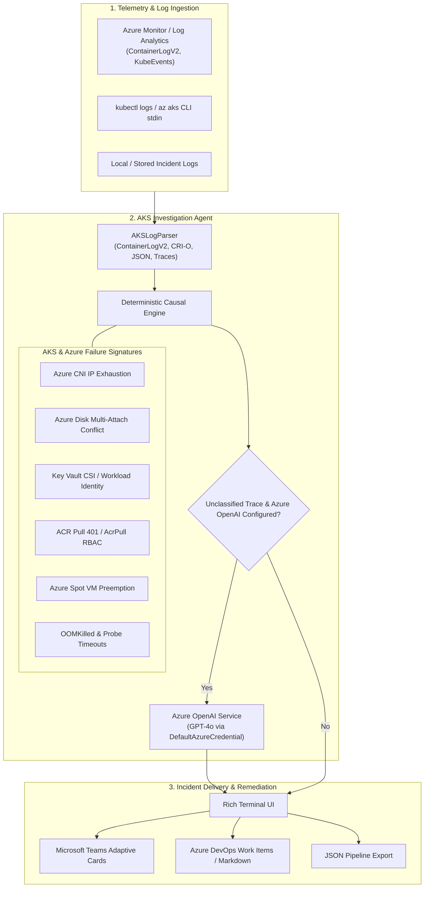

# ☁️ Azure Kubernetes Service (AKS) Investigation Agent

[](LICENSE)
[](pyproject.toml)
[](HOWTO.md)

An autonomous incident investigation agent designed specifically for **Azure Kubernetes Service (AKS)**, **Azure Monitor (ContainerLogV2 / KubeEvents)**, and **Azure OpenAI Service**.

👉 **[Read the Step-by-Step HOWTO & Usage Recipes Guide (HOWTO.md)](HOWTO.md)**

The agent ingests AKS container runtime logs, event streams, or direct Azure Log Analytics telemetry, performs deep causal failure analysis across Azure cloud-infrastructure boundaries, catalogs empirical supporting evidence, and generates actionable `az aks` and `kubectl` remediation plans.

---

## 🌟 Key Capabilities

- **Azure-Specific Cloud Failure Mode Diagnostics**:
  - **Azure CNI IP Exhaustion**: Detects VNet subnet address depletion preventing pod sandbox initialization.
  - **Azure Managed Disk Multi-Attach**: Identifies `ReadWriteOnce` storage volume locks across AKS nodes.
  - **Azure Key Vault CSI Provider**: Diagnoses Workload Identity token failures, expired service principals, and 401/403 access denials.
  - **Azure Container Registry (ACR) Authentication**: Diagnoses `ImagePullBackOff` caused by missing `AcrPull` RBAC role assignments on the AKS Kubelet identity.
  - **Azure Spot VM Eviction**: Detects scheduled Spot capacity preemptions and node deallocations.
  - **Azure Policy (Gatekeeper)**: Identifies admission webhook policy enforcement rejections.
  - **Standard Kubernetes Incidents**: OOMKilled (Exit Code 137), CoreDNS timeouts, database connection pool exhaustion, cascading CrashLoopBackOff restarts.
- **Direct Azure Monitor & Log Analytics Ingestion**:
  - Ingests `ContainerLogV2`, `ContainerLog`, and `KubeEvents` natively via KQL and the `azure-monitor-query` SDK.
- **Enterprise Azure OpenAI Integration**:
  - Powered by **Azure OpenAI Service** (GPT-4o / GPT-4o-mini).
  - Authenticates securely via **Azure Entra ID (`DefaultAzureCredential`)** with zero hardcoded API keys, or via Azure OpenAI API keys.
  - Diagnoses unclassified application stack traces (C#, Java, Python, Go, Node.js).
- **Incident Delivery & ChatOps**:
  - **Rich Interactive Terminal** with Azure blue styling and status badges.
  - **Microsoft Teams Adaptive Cards** posted directly to Teams webhooks.
  - **Azure DevOps / GitHub Flavored Markdown** for incident work items.
  - **Machine-readable JSON** for automated alerting pipelines.

---

## 🏗️ Architecture



---

## 📋 Prerequisites & System Requirements

Before cloning and running the AKS agent, ensure the following requirements are met:

### 1. System Requirements
| Requirement | Specification | Notes |
| :--- | :--- | :--- |
| **Operating System** | Linux, macOS, or Windows | Fully cross-platform (Bash, Zsh, PowerShell). |
| **Python** | **Python 3.9+** (3.10 – 3.12 recommended) | Check with `python --version` or `python3 --version`. |
| **Package Manager** | `pip` (or `poetry`, `conda`, `uv`) | Standard Python package installer. |
| **Virtual Environment** | Recommended (`venv` or `conda`) | Isolates dependencies from system Python. |

### 2. Optional CLI Tools
- **Azure CLI (`az`)** *(Optional but recommended)*: Version 2.45+ for cluster authentication and executing generated `az aks` remediation commands:
  ```bash
  az login
  ```
- **`kubectl`** *(Optional)*: Recommended for live log streaming and cluster inspection:
  ```bash
  az aks get-credentials --resource-group myRG --name myCluster
  ```

### 3. Network & Connectivity
- **Offline / Local Mode**: **Air-gapped safe**. Zero network connectivity, zero cloud accounts, and zero credentials needed to analyze local files, exported `ContainerLogV2` CSV/JSON files, or stdin pipes.
- **Azure Monitor Querying**: Requires outbound HTTPS (Port 443) to `https://api.loganalytics.io`.
- **Azure OpenAI Diagnosis**: Requires outbound HTTPS (Port 443) to `https://<your-resource>.openai.azure.com`.
- **Teams Notifications**: Requires outbound HTTPS (Port 443) to `https://outlook.office.com`.

### 4. Cloud Permissions & RBAC Roles (Only for Cloud-Connected Features)

If querying Azure Log Analytics or invoking Azure OpenAI directly from the CLI:

| Feature | Required Azure RBAC Role | Environment Variables |
| :--- | :--- | :--- |
| **Azure Monitor / Log Analytics Querying** | **Log Analytics Reader** (or *Monitoring Reader*) on the workspace/resource group | `AZURE_LOG_ANALYTICS_WORKSPACE_ID` |
| **Azure OpenAI Service (Passwordless)** | **Cognitive Services OpenAI User** on the Azure OpenAI resource | `AZURE_OPENAI_ENDPOINT`<br>`AZURE_OPENAI_DEPLOYMENT` |
| **Azure OpenAI Service (API Key)** | N/A (Key-based authentication) | `AZURE_OPENAI_KEY`<br>`AZURE_OPENAI_ENDPOINT`<br>`AZURE_OPENAI_DEPLOYMENT` |
| **Microsoft Teams Webhook** | Webhook Connector created in target Teams Channel | Pass via `--teams-webhook <url>` |

---

## 🚀 Quick Installation

```bash
# 1. Clone the repository
git clone https://github.com/manjulearnings/aks-investigation-agent.git
cd aks-investigation-agent

# 2. Create and activate a virtual environment
# Windows (PowerShell):
python -m venv venv
.\venv\Scripts\Activate.ps1

# Linux / macOS:
python3 -m venv venv
source venv/bin/activate

# 3. Install the agent
pip install -e .
```

> [!TIP]
> Looking for copy-paste workflows and practical recipes? Check out the **[Complete HOWTO Guide](HOWTO.md)**!

---

## 💻 CLI Usage

The agent installs a CLI command `aks-agent` (or `python -m aks_agent.cli`). For full step-by-step recipes and advanced options, see the **[HOWTO Guide](HOWTO.md)**:

### 1. Analyze a Local Log File
```bash
aks-agent sample_logs/01_azure_cni_ip_exhaustion.log
```

### 2. Stream Live Logs from `az aks` or `kubectl`
```bash
az aks command invoke \
  --resource-group myRG \
  --name myAKSCluster \
  --command "kubectl logs pod/payment-gateway-6f987dbf54-zk92w --previous" | aks-agent -
```

### 3. Query Azure Monitor / Log Analytics Directly via KQL
```bash
aks-agent --query-monitor \
  --workspace-id "11223344-5566-7788-99aa-bbccddeeff00" \
  --pod "payment-gateway" \
  --hours 2
```

### 4. Post Incident Card Directly to Microsoft Teams
```bash
aks-agent sample_logs/01_azure_cni_ip_exhaustion.log \
  --teams-webhook "https://outlook.office.com/webhook/your-teams-webhook-url"
```

### 5. Generate Markdown for Azure DevOps Work Items
```bash
aks-agent crash.log --format markdown --output azdo-incident.md
```

---

## 🔐 Azure Authentication Setup

### Authenticating with Azure OpenAI
The agent supports **zero-secret authentication** via Azure Entra ID / Managed Identity:

```bash
# 1. Log in with Azure CLI (or run inside an AKS pod with Workload Identity)
az login

# 2. Configure endpoint
export AZURE_OPENAI_ENDPOINT="https://my-openai-resource.openai.azure.com/"
export AZURE_OPENAI_DEPLOYMENT="gpt-4o"

# Optional: API Key if not using Entra ID
export AZURE_OPENAI_KEY="your-azure-openai-key"
```

### Authenticating with Azure Monitor
Ensure your account or Managed Identity has the **Log Analytics Reader** role on the target workspace:

```bash
export AZURE_LOG_ANALYTICS_WORKSPACE_ID="11223344-5566-7788-99aa-bbccddeeff00"
```

---

## 🧪 Running the Test Suite

```bash
pytest
```

---

## ⚖️ License
Apache-2.0

