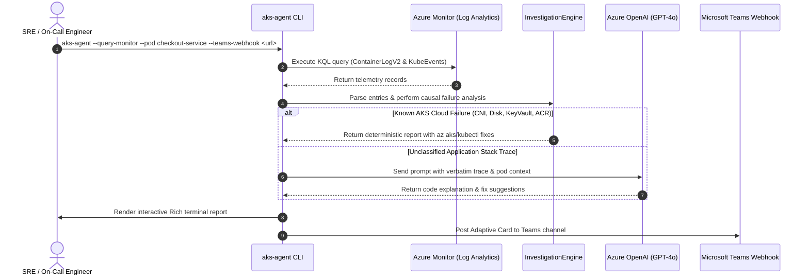

# 🏗️ AKS Investigation Agent Architecture

This document details the architectural design and sequence flows of the **AKS Investigation Agent**.

## Component Overview

1. **`AKSLogParser` (`aks_agent/parser.py`)**:
   - Ingests multiple formats: CRI-O, containerd, Docker standard, Kubernetes events, and Azure Monitor `ContainerLogV2` (JSON/CSV).
   - Reassembles multi-line language stack traces (Python, Java, Go, Node.js, .NET).

2. **`InvestigationEngine` (`aks_agent/engine.py`)**:
   - Evaluates AKS-specific failure modes:
     - `AZURE_CNI_IP_EXHAUSTION`
     - `AZURE_DISK_MULTI_ATTACH`
     - `AZURE_KEYVAULT_CSI_FAILURE`
     - `ACR_UNAUTHORIZED_IMAGE_PULL`
     - `AZURE_SPOT_EVICTION`
     - `AZURE_POLICY_DENIAL`
     - `OOM_KILLED`
     - `DB_CONNECTION_FAILURE`
     - `DNS_RESOLUTION_FAILURE`
   - Differentiates root causes from secondary cascading symptoms (probes, `CrashLoopBackOff`).
   - Catalogs verbatim empirical evidence lines and constructs chronological incident progression timelines.

3. **`AzureOpenAIInvestigator` (`aks_agent/azure_ai.py`)**:
   - Connects to Azure OpenAI Service using Entra ID (`DefaultAzureCredential`) or API key.
   - Diagnoses unclassified custom application errors and stack traces.

4. **`AzureMonitorLogFetcher` (`aks_agent/azure_monitor.py`)**:
   - Executes KQL against Azure Log Analytics `ContainerLogV2` and `KubeEvents`.

5. **`Reporters` (`aks_agent/reporters.py`)**:
   - `TerminalReporter`: Azure blue Rich console UI.
   - `MarkdownReporter`: Azure DevOps / GitHub incident templates.
   - `JSONReporter`: CI/CD automation.
   - `TeamsAdaptiveCardReporter`: Microsoft Teams Adaptive Cards with quick-action remediations.

## Sequence Flow: Azure Monitor Investigation

